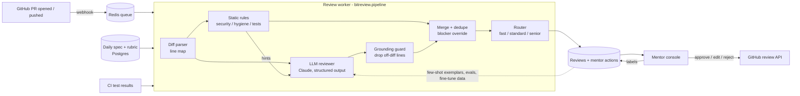

# Technical Approach: BitReview, the AI co-reviewer for BitElevate PRs

This document covers the problem, architecture, data pipeline, model choices, prompt design, guardrails, evaluation, cost, deployment and execution plan. The code is in [`bitreview/`](../bitreview), the demo in [`app.py`](../app.py) and the evaluation in [`eval/run_eval.py`](../eval/run_eval.py).

---

## 1. Problem and success criteria

**Today:** an intern pushes the day's PR. A senior evaluator reads the diff against the daily spec, writes inline comments, and approves or requests changes. Quality depends on the mentor's time and attention, and turnaround depends on the queue.

**Goal:** cut mentor minutes per PR and time to first feedback **without** lowering feedback quality or letting unreviewed AI output reach students.

| Metric | Target after Phase 2 | How it's measured |
|---|---|---|
| Mentor minutes per PR | −40% vs baseline | Time in the console, per lane |
| Comment acceptance (accepted unedited) | ≥ 60% | Console accept/edit/reject events |
| Blocker recall (security + correctness) | ≥ 95% | Labelled eval set + mentor-added comments |
| False "approve" on PRs mentors rejected | ≤ 2% | Shadow-mode comparison |
| Time to first draft | < 60 s at p95 | Queue timestamps |

---

## 2. Architecture



Key principle: **the model drafts and the system decides how much human attention is needed.** No path posts to GitHub without a mentor click.

---

## 3. Data pipeline

### 3.1 Inputs
| Input | Source | Notes |
|---|---|---|
| PR diff | GitHub App (`GET /pulls/{n}` with `Accept: application/vnd.github.diff`) | Unified diff. The PoC accepts a `.diff` file (`gh pr diff 42 > pr.diff`). |
| Daily spec | Intern portal DB → YAML/JSON (`TaskSpec`) | Objective, file targets, acceptance criteria, weighted rubric, mentor notes. |
| CI results | GitHub Actions check runs | Phase 2: pass/fail per acceptance test, given to the model as evidence. |
| Mentor history | Past review comments | Phase 3: retrieved as few-shot examples per rubric criterion. |

### 3.2 Processing
1. **Parse the diff into a line map** ([`diff_parser.py`](../bitreview/diff_parser.py)). For each file, map line numbers in the new file to added and context lines. This one structure supports three things: static checks, the line-numbered rendering for the LLM (`+  17| code`), and the grounding guard. GitHub only accepts inline comments on lines that are in the diff.
2. **Run the static rules** ([`static_checks.py`](../bitreview/static_checks.py)). Line rules cover hard-coded secrets, SQL built from strings, plain-text passwords, JWT without verification or expiry, bare `except`, Redis `KEYS *`, cache writes without TTL, `assert True`, leftover prints and TODOs. PR-level rules cover missing tests, files outside the spec's targets, and oversized PRs.
3. **Run the LLM review** ([`llm_reviewer.py`](../bitreview/llm_reviewer.py)) on the spec, the static hints and the numbered diff. It returns a schema-validated `LLMReview`.
4. **Merge and enforce policy** ([`pipeline.py`](../bitreview/pipeline.py)):
   - Run the grounding guard.
   - Deduplicate on (file, line, category), preferring the LLM's wording and keeping the higher severity.
   - Add a prompt-injection finding if needed.
   - Compute the weighted rubric score.
   - Apply the blocker override: a confirmed blocker always means `request_changes`.
5. **Route** ([`router.py`](../bitreview/router.py)) to fast track (~2 min), standard (~5 min) or senior escalation (~12 min), with reasons.
6. **Export** ([`github_export.py`](../bitreview/github_export.py)) only the comments the mentor approved, as a GitHub "create review" payload.

### 3.3 The feedback loop (the long-term data asset)
Each mentor action is stored as `(spec, diff hunk, AI comment, action ∈ {accept, edit, reject}, final text)`. That gives:
- **An eval set that grows itself**: every rejected AI comment is a precision example, and every comment a mentor adds is a recall example.
- **Few-shot retrieval**: embed past accepted comments per rubric criterion (pgvector, or Pinecone, which Cynbit already lists) and include the top-k in the prompt, so the AI learns each lab's house style.
- **Fine-tuning data** later, if volume justifies a smaller self-hosted model.

---

## 4. Model choices

| Layer | Choice | Why |
|---|---|---|
| Static rules | Regex/heuristic rules (Python) | Free, instant and deterministic. Security blockers must never depend on model sampling. Disagreement with the LLM is a useful escalation signal. Also the fallback when the API is down. |
| Reviewer LLM | **Claude Opus 5.5** (`claude-opus-5-5`), adaptive thinking, effort `high` | Reviewing code against a spec needs real reasoning, e.g. spotting `limit(size - 1)` or a test that can't fail. In my offline eval these reasoning-only issues are exactly where rules fail (2 of 6 found). |
| Cheaper triage (Phase 2) | **Claude Haiku 5.5** at low effort on every PR; Opus only for PRs Haiku flags or scores below threshold | Most daily PRs are small and fine. Tiering cuts cost by roughly 3x (see §7). Configured with `BITREVIEW_MODEL`; the decision is driven by the eval. |
| Output format | Structured outputs (`client.beta.messages.parse(output_format=LLMReview)`) | The SDK validates against the Pydantic schema, so there is no fragile JSON parsing. |
| Safety fallback | Server-side refusal fallback (`fallbacks="default"`) | Security-heavy diffs can occasionally trip a safety classifier. The API retries on a suitable model within the same call. If the whole chain refuses, the pipeline drops to offline rules and escalates. |
| Retrieval (Phase 3) | Text embeddings + pgvector | Past mentor comments as few-shot examples per criterion. |
| **Not chosen now:** fine-tuning a code model | Too early | No labelled data yet. Prompting with a rubric plus retrieval reaches useful quality first, and the console builds the dataset that would justify fine-tuning later. |

---

## 5. Prompt engineering

Prompt layout, ordered so that the stable content comes first for caching:

```
system:   reviewer role, scoring scale, priorities, comment style, verdict rules,
          prompt-injection policy                                      ← identical for all PRs
user[0]:  <daily_spec> lab, day, objective, file targets, acceptance criteria,
          weighted rubric, mentor notes </daily_spec>   [cache_control]  ← identical per day
user[1]:  <automated_check_hints> static findings JSON </automated_check_hints>
          <diff> line-numbered diff </diff>                              ← per PR
output:   LLMReview { summary, criterion_scores[], findings[], verdict, confidence, learning_tip }
```

Decisions and the reasons behind them:

1. **The rubric is the contract.** The model scores each criterion 0–4 with cited evidence (`file:line`). Evidence makes scores checkable and stops them being vibes.
2. **Line-numbered diff.** Rendering `+  17| code` lets the model cite exact lines. The grounding guard then checks every citation.
3. **Static findings go in as hints, not truth.** The model confirms, refines (better wording, more context) or dismisses false positives. Rules give recall on known patterns and the model gives judgement.
4. **Mentor voice.** Each comment explains *why*, then gives a concrete fix. There's one `praise` finding per PR and at most 3 minor nits, because feedback that only criticises hurts learning.
5. **Calibrated confidence.** The model is asked to lower confidence when it can't verify behaviour without running code. The router uses this.
6. **Injection-safe framing.** The diff is fenced in `<diff>`, the system prompt says its contents are data, and attempts to sway the reviewer must be reported as security findings. A regex detector in the pipeline adds defence in depth.
7. **Caching.** In a cohort, hundreds of interns submit against the same daily spec, so `system + daily_spec` is a cache prefix that gets reused heavily.

---

## 6. Guardrails (human in the loop by design)

| Guardrail | Where | Behaviour |
|---|---|---|
| No auto-publish | Console + export | Only comments the mentor ticks are exported; nothing posts automatically. |
| Blocker override | `pipeline.py` | Any confirmed blocker forces `request_changes`, even if the LLM says approve. |
| Disagreement escalation | `router.py` | Rules found a blocker but the LLM would approve → senior escalation. Tested in `test_blocker_overrides_llm_approval`. |
| Grounding guard | `pipeline.py` | Comments on lines not in the diff are dropped. 3 or more drops → escalation. |
| Prompt-injection detection | `pipeline.py` + system prompt | Becomes a blocker finding and a senior escalation. Demonstrated by `pr03_jwt_injection`. |
| Confidence floor | `router.py` | LLM confidence < 0.6 → escalation. Fast track needs ≥ 0.85 and an approve. |
| Never silently truncate | `diff_parser.py` | Oversized diffs raise `DiffTooLargeError` and go to a human; they are never cut. |
| API failure or refusal | `llm_reviewer.py` | Typed exception chain (auth, rate limit, status, connection) and a `refusal` stop reason both lead to the offline reviewer plus escalation. |

---

## 7. Evaluation

### 7.1 Offline eval set (in this repo)
There are 8 PRs across 3 BitElevate-style daily specs (Python Backend Lab: Day 9 pagination bug hunt, Day 12 JWT auth, Day 23 Redis caching). They contain 24 labelled issues, and each issue is tagged by whether a rule could catch it (`rule_detectable`):

- 3 clean PRs (should be approved with no false blockers)
- 5 flawed PRs: insecure auth, prompt injection with signature verification disabled, a bad cache (no TTL, `KEYS *`, `assert True`), SQL injection, and a subtle off-by-one with a weak test

```bash
python eval/run_eval.py          # offline baseline, free
python eval/run_eval.py --llm    # Claude reviewer, needs ANTHROPIC_API_KEY (8 calls)
```

**Offline baseline results (rules + heuristics, measured):**

| Metric | Result |
|---|---|
| Verdict accuracy | 7/8 (88%): it wrongly **approves** the subtle off-by-one PR |
| Issue recall, rule-detectable | 18/18 (100%) |
| Issue recall, reasoning-only | **2/6 (33%)** |
| Blocker/major precision | 13/13 (100%) |
| False blocks on clean PRs | 0/3 |

Honest reading of these numbers:

- I developed the rules on this same small set. That makes the rule-detectable numbers optimistic, a train/test leak I'd fix by holding out real PRs in Phase 1.
- The point of the baseline is the **gap**. Rules can't see logic errors or weak tests, and they approved a buggy PR. That gap is the case for the LLM layer, and the `--llm` run measures how much of it Claude closes.
- I did not have an API key in the build environment, so the LLM path is covered by unit tests with a mocked client (request shape, grounding guard, blocker override, refusal fallback, schema acceptance by the SDK) rather than a measured live run.

### 7.2 Growing the eval
- **Phase 1:** collect 200+ real PRs with mentor reviews across all labs. Hold out 30% as a test set and never tune prompts on it.
- **Track per category:** security, correctness, testing, spec, performance, hygiene. Track per lab too, since frontend and design labs will need their own rules.
- **Score comment quality** with an LLM judge, using a mentor-written rubric (specific? actionable? correct?). Calibrate it against 50 human-graded comments.

### 7.3 Online metrics (shadow and assisted modes)
- Comment acceptance, edit and reject rates
- Mentor minutes per lane
- Agreement between AI verdict and mentor verdict
- Time to first feedback
- Intern resubmission count
- Fast-track spot-check failure rate (10% random audit)

---

## 8. Cost and latency

Token estimate for a typical daily PR (~150 changed lines):

| Part | Tokens |
|---|---|
| System prompt | ~700 |
| Daily spec + rubric | ~600 |
| Line-numbered diff + hints | ~3,500 |
| **Input total** | **~5k** |
| Output (review + adaptive thinking) | ~3k |

| Strategy | Input $/1M | Output $/1M | Cost per PR | ≈ ₹ per PR (₹85/$) |
|---|---|---|---|---|
| Opus 5.5 on every PR | $4 | $20 | 5k×4 + 3k×20 = **$0.080** | ~₹6.8 |
| Haiku 5.5 on every PR | $0.10 | $0.50 | **$0.002** | ~₹0.2 |
| Tiered: Haiku on all, Opus on ~35% | | | ≈ $0.030 | **~₹2.6** |

Prompt caching of the `system + spec` prefix trims input cost a little more. The diff dominates, so caching mainly helps latency. Cost per cohort (15,000 PRs, tiered) is about ₹40–45k.

**Latency:** the draft takes 15–60 s per PR at `high` effort. It runs async from the webhook, so the mentor console is never blocked.

---

## 9. Deployment design (production)

- **Service:** FastAPI app with webhook receiver, mentor console API and review worker. Redis queue with RQ or Celery, Postgres for specs, reviews and mentor actions. Docker on AWS (ECS or EKS). This matches the stack Cynbit lists and the BitElevate curriculum itself.
- **GitHub App** with least privilege: `pull_requests: write`, `contents: read`, installed on the BitElevate org. Comments are posted as "BitElevate Mentor", with the mentor's name in the body.
- **Secrets** in AWS Secrets Manager. No student personal data in prompts; only diffs and specs are sent.
- **Observability:** per-review tokens, latency, lane, confidence, drop count and errors. A weekly dashboard of AI–mentor agreement per lab.
- **Config:** `BITREVIEW_MODEL`, `BITREVIEW_EFFORT`, lane thresholds and rules per lab, all versioned so eval results tie back to a configuration.

---

## 10. Execution plan

| Week | Deliverable | Exit criterion |
|---|---|---|
| 0 | PoC (this repo) | Pipeline, eval harness and console work offline; unit tests green |
| 1 | GitHub App + webhook + queue; specs imported from the portal for the Python Backend Lab | Drafts appear for 100% of new PRs in that lab |
| 2–3 | **Shadow mode**: mentors see drafts beside their normal flow | ≥ 200 labelled PRs; first live precision/recall numbers; prompt v2 |
| 4–5 | **Assisted mode** in one lab: mentors send edited drafts; routing lanes on | Acceptance ≥ 60%, mentor min/PR −30%, 0 unreviewed sends |
| 6–7 | Haiku triage tier; retrieval of past mentor comments | Same quality at ≤ ₹3/PR |
| 8–12 | Roll out to all 6 labs (per-lab rules for frontend, QA, UI/UX); expose the engine to Cynbit Studio's AI Review stage | KPIs from §1 met per lab |

---

## 11. Known limitations of the PoC

- The rule set is Python-backend focused. Frontend, QA and design labs need their own rules (ESLint, Playwright, Figma-token checks).
- The reviewer sees only the diff, not the full repo. Phase 2 adds selected file context (imports, called functions) through retrieval or tool use.
- CI results are not yet fed in. Running tests is better evidence than reading them.
- Mentor-minute figures are planning assumptions until shadow mode measures them.
